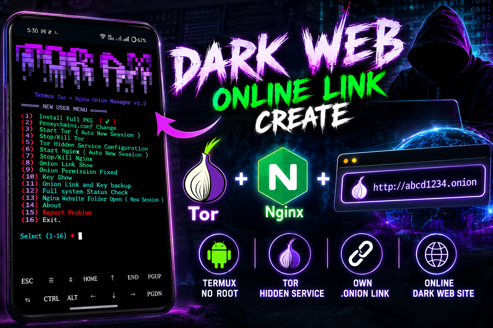

<!-- ═══════════════ HEADER (Animated Wave) ═══════════════ -->
<p align="center">
  
</p>

<!-- ═══════════════ BANNER IMAGE ═══════════════ -->
<p align="center">
  
</p>

<!-- ═══════════════ TYPING ANIMATION ═══════════════ -->
<p align="center">
  <a href="https://github.com/Xylon-404/TOR">
    
  </a>
</p>

<!-- ═══════════════ BADGES ═══════════════ -->
<p align="center">
  
  
  
  
  
</p>

<p align="center">
  
  
  
  
</p>

<p align="center">
  
</p>

---

## 🧅 About | পরিচিতি

**Termux Tor + Nginx Onion Manager** হলো একটি সম্পূর্ণ **all-in-one** টুল, যা দিয়ে মাত্র **১টি টুলেই** আপনি Termux থেকে নিজের **Tor Hidden Service (.onion link)** তৈরি ও ম্যানেজ করতে পারবেন।

> ✅ Tor Install → Hidden Service Config → Nginx Start → **Onion Link Ready!**
> সবকিছু একটি সুন্দর মেনু থেকে।

---

## ✨ Features | ফিচারসমূহ

<table align="center">
  <tr>
    <td align="center" width="33%">
      <h3>📦 Full PKG Install</h3>
      <p>এক ক্লিকে সব প্রয়োজনীয় প্যাকেজ ইনস্টল</p>
    </td>
    <td align="center" width="33%">
      <h3>🧅 Tor Control</h3>
      <p>Start / Stop / Kill + Auto New Session</p>
    </td>
    <td align="center" width="33%">
      <h3>🌐 Nginx Control</h3>
      <p>Start / Stop / Kill + Auto New Session</p>
    </td>
  </tr>
  <tr>
    <td align="center">
      <h3>🔗 Onion Link Show</h3>
      <p>আপনার .onion লিংক সহজেই দেখুন</p>
    </td>
    <td align="center">
      <h3>🔑 Key Show & Backup</h3>
      <p>Onion Link ও Key ব্যাকআপ নিন</p>
    </td>
    <td align="center">
      <h3>🛠 Permission Fixed</h3>
      <p>Onion permission সমস্যা অটো ফিক্স</p>
    </td>
  </tr>
  <tr>
    <td align="center">
      <h3>📊 System Status</h3>
      <p>Full system status check</p>
    </td>
    <td align="center">
      <h3>📁 Website Folder</h3>
      <p>Nginx website folder সরাসরি ওপেন</p>
    </td>
    <td align="center">
      <h3>⚙️ Proxychains</h3>
      <p>proxychains.conf সহজে পরিবর্তন</p>
    </td>
  </tr>
</table>

---

## 📋 Menu Preview | মেনু

```text
====== NEW USER MENU ======

{1}  Install Full PKG  [ ✔ ]
{2}  Proxychains.conf Change
{3}  Start Tor ( Auto New Session )
{4}  Stop/Kill Tor
{5}  Tor Hidden Service Configuration
{6}  Start Nginx ( Auto New Session )
{7}  Stop/Kill Nginx
{8}  Onion Link Show
{9}  Onion Permission Fixed
{10} Key Show
{11} Onion Link and Key backup
{12} Full system Status Check
{13} Nginx Website Folder Open ( New Session )
{14} About
{15} Report Problem
{16} Exit

{↳} Select (1-16) ➜
```

---

## 🚀 Installation | ইনস্টলেশন

### 📱 Requirements
- 📲 Android ফোন
- 🖥 [Termux](https://github.com/termux/termux-app) (F-Droid / GitHub থেকে)
- 🐍 Python (Termux-এর latest)
- 🌍 Internet Connection
- 🧬 Architecture: `aarch64`

### ⚡ Quick Start

```bash
# 1️⃣ Termux আপডেট করুন
pkg update -y && pkg upgrade -y

# 2️⃣ Git ও Python ইনস্টল করুন
pkg install git python -y

# 3️⃣ Repository Clone করুন
git clone https://github.com/Xylon-404/TOR.git

# 4️⃣ ফোল্ডারে ঢুকুন
cd TOR

# 5️⃣ টুল রান করুন
python run.py
```

<p align="center">
  
</p>

---

## 📂 Project Structure | ফাইল স্ট্রাকচার

```text
TOR/
├── 📄 README.md
├── 🐍 run.py                                            # Main launcher
├── ⚙️ maindata.so                                       # Core data module
├── 🔒 protected_core.cpython-314-aarch64-linux-android.so  # Protected core
└── 🖼 image No/                                         # README images
```

---

## 🧭 How To Use | ব্যবহারের নিয়ম

| Step | কাজ | Menu |
|:---:|---|:---:|
| 1️⃣ | সব প্যাকেজ ইনস্টল করুন | `1` |
| 2️⃣ | Tor চালু করুন | `3` |
| 3️⃣ | Hidden Service কনফিগার করুন | `5` |
| 4️⃣ | Nginx চালু করুন | `6` |
| 5️⃣ | আপনার Onion Link দেখুন | `8` |
| 6️⃣ | Tor Browser-এ লিংক ওপেন করুন 🎉 | — |
| 💾 | Key ও Link ব্যাকআপ নিন | `11` |

> 🌐 ওয়েবসাইট ফাইল রাখতে **Option 13** দিয়ে Nginx website folder ওপেন করুন।

---

## 🛠 Troubleshooting | সমস্যা সমাধান

<details>
<summary><b>❓ Onion link কাজ করছে না?</b></summary>

- Option `9` (Onion Permission Fixed) চালান
- Tor ও Nginx দুটোই চালু আছে কিনা Option `12` দিয়ে চেক করুন
- Tor বন্ধ করে আবার Option `3` দিয়ে চালু করুন
</details>

<details>
<summary><b>❓ .so file load error আসছে?</b></summary>

- আপনার Termux **aarch64** আর্কিটেকচারে আছে কিনা দেখুন: `uname -m`
- Python ভার্সন ফাইলের নামের সাথে মিলতে হবে (`cpython-314` = Python 3.14)
- `pkg upgrade` করে Python আপডেট করুন
</details>

<details>
<summary><b>❓ Package install হচ্ছে না?</b></summary>

```bash
termux-change-repo
pkg update -y
```
</details>

<details>
<summary><b>❓ অন্য কোনো সমস্যা?</b></summary>

টুলের মেনু থেকে Option `15` (Report Problem) ব্যবহার করুন অথবা GitHub-এ [Issue](https://github.com/Xylon-404/TOR/issues) খুলুন।
</details>

---

## ⚠️ Disclaimer | সতর্কতা

> এই টুলটি শুধুমাত্র **শিক্ষামূলক ও বৈধ কাজের** জন্য তৈরি। নিজের Hidden Service-এ আপনি কী হোস্ট করছেন তার সম্পূর্ণ দায়িত্ব আপনার। অবৈধ কাজে ব্যবহার করলে **ডেভেলপার কোনোভাবেই দায়ী থাকবে না।**
> 🔐 আপনার **Onion Key** কখনো কাউকে শেয়ার করবেন না।

---

## 🤝 Contribute & Support

<p align="center">
  <a href="https://github.com/Xylon-404/TOR/issues"></a>
  <a href="https://github.com/Xylon-404/TOR/fork"></a>
  <a href="https://github.com/Xylon-404/TOR"></a>
</p>

## 👨‍💻 Developer

<p align="center">
  <a href="https://github.com/Xylon-404">
    
  </a>
</p>

<p align="center">
  
</p>

<p align="center">
  
</p>

<!-- ═══════════════ FOOTER (Animated Wave) ═══════════════ -->
<p align="center">
  
</p>
